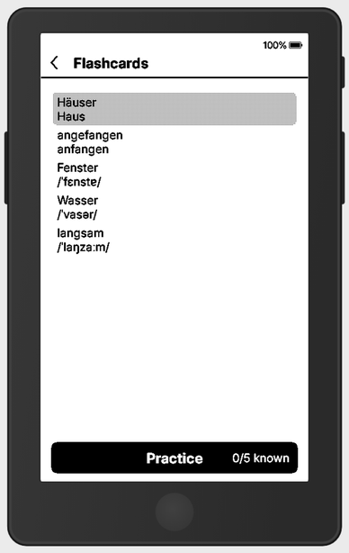
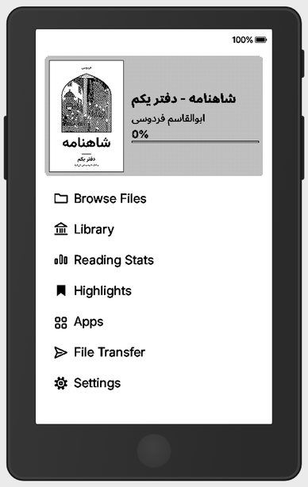
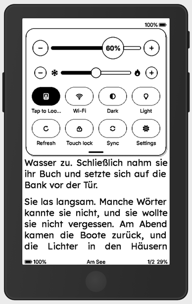
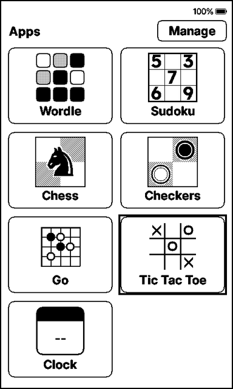
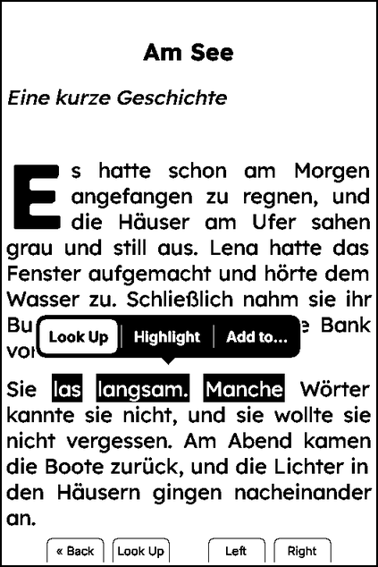

<p align="center">
  
</p>

<p align="center">
  <b>E-reader firmware for the Xteink X4 Pro, with the features of CrossInk and VARAGH.</b>
</p>

<p align="center">
  <a href="LICENSE"></a>
</p>

<p align="center">
  <a href="FEATURES.md"><b>Features</b></a> ·
  <a href="#install"><b>Install</b></a> ·
  <a href="#build-from-source"><b>Build from source</b></a> ·
  <a href="CHANGELOG.md"><b>Changelog</b></a> ·
  <a href="#credits-and-licences"><b>Credits</b></a>
</p>

**NeuInk** is e-reader firmware for the **Xteink X4 Pro**. The X4 Classic and X3 can
also be built, but they are experimental and have not been tested on hardware.
It is a fork of [VARAGH](https://github.com/PewPewzxc/VARAGH), which is itself a fork of
[CrossInk](https://github.com/uxjulia/crossink), which in turn comes from
[CrossPoint Reader](https://github.com/crosspoint-reader/crosspoint-reader). Each fork
keeps the features of the one before it.

The X4 Pro gets every feature, with touch and a front light. The X4 Classic and X3 have
no touch screen or front light, so their code path works with the buttons only (see
[Experimental readers](#experimental-readers-x4-classic-and-x3)).

> NeuInk is an independent community project, not affiliated with or endorsed by
> Xteink, CrossInk, CrossPoint or VARAGH.

**Contents:** [What it adds](#what-neuink-adds) · [Install](#install) ·
[Build from source](#build-from-source) · [Contributing](#contributing) ·
[Credits](#credits-and-licences)

## What NeuInk adds

These are the features this fork inherits from VARAGH on top of CrossInk. The full
list, with photos and how to use each one, is in **[FEATURES.md](FEATURES.md)**.

### Words and dictionaries

- **Tap to Look Up:** one tap on a word opens its meaning.
- **Long Press on a Word:** look up, highlight, add to a category, or Ask with a
  bubble at the words.
- **Hold to Select:** choose how long a finger rests on a word before selection
  opens: Fast, Normal, Slow or Very slow.
- **Selection handles** to resize a selection, on the touch screen or with the
  buttons.
- **Dictionaries:** an offline dictionary per language, plus optional online sources
  (Wiktionary, Wikipedia, Datamuse and OpenThesaurus). Online results are saved on the
  card after the first lookup. Back cancels a lookup at once.
- **Remembers your choice:** the last dictionary stays the default; Switch Dictionary
  at any time.

### Highlights and flashcards

- **Highlights hub on Home:** Favorite Lines, your own categories and By Book.
- **Add to…** straight from the dictionary.
- **Flashcards:** Leitner boxes with *Again* / *Know it* and Practice.
- **Swipe left to delete** in files, recent books, highlights, bookmarks, lookup
  history and categories.

### Books and ratings

- **Drop caps, text and heading sizes**, bordered and lightly shaded boxes, and
  tables, as the publisher made them.
- **Smooth grey pictures** without a crosshatch pattern, on clean white paper.
- **Line breaks after hyphens and dashes.**
- **Book ratings:** five stars with halves, at the end of a book, in the book menu,
  in Reading Stats and in Library.
- **Next in series** at the end of a book.

### Screen, light and controls

- **Settings in eight groups**, each with an icon and a short description.
- **Control Center:** swipe down for light and warmth in 1 % steps, with eight buttons
  you choose (X4 Pro).
- **Night light:** a second brightness and warmth from evening to morning (X4 Pro).
- **Rotation** that turns the buttons and the touch screen with the page.
- **Bluetooth page turner:** pair a remote and map its buttons.

### Apps and clock

- **Games:** Sudoku with five levels, a daily puzzle and explaining hints,
  Chess, Checkers, Go and Tic Tac Toe. Apps stay open across sleep, and you can hide
  the ones you do not use.
- **Clock & Calendar**, also as a sleep screen.
- **A clock that stays right:** set on every Wi-Fi connect, with a manual time zone,
  Summer Time and an optional Live Clock. NeuInk does not look up your location.

### Speed and battery

- **Fast chapters:** long chapters show their first page at once (Automatic indexing),
  with a faster SD card and fonts kept in memory.
- **Fast picture pages:** the next page's pictures are prepared while you read.
- **Battery:** the processor slows down sooner and the display powers down when idle,
  while buttons still respond instantly.

### Languages

Inherited from VARAGH, and not the main focus of this fork: English, German and
Persian are built in, with right-to-left Persian and Arabic script, IPA pronunciations
and menus in 29 languages (the extra languages download as small packs). A Persian
keyboard layout is included.

<table>
  <tr>
    <td align="center" width="50%"><br><b>Flashcards</b></td>
    <td align="center" width="50%"><br><b>Home</b></td>
  </tr>
</table>

## Install

Download the latest firmware file for the X4 Pro, `firmware-x4-pro.bin`, from the
[releases page](https://github.com/voxain/NeuInk/releases). To build it yourself instead,
see [Build from source](#build-from-source).

To flash a firmware file from an SD card, copy it to the card and use
**Settings → System → SD Card Firmware Update**. If you are coming from the original
Xteink firmware, read the [installation guide](docs/installation.md) first.

Optional: a German → English dictionary, see [Dictionaries](docs/neuink/DICTIONARIES.md).

### Leaving NeuInk

If NeuInk is not for you, **Settings → System → Switch to Another Firmware** installs
the latest release of VARAGH, CrossInk or CrossPoint over WiFi, with no computer. It uses
the same update mechanism as NeuInk's own updates, pointed at their repositories:

| Choice | Repository |
|---|---|
| VARAGH | [PewPewzxc/VARAGH](https://github.com/PewPewzxc/VARAGH) |
| CrossInk | [uxjulia/crossink](https://github.com/uxjulia/crossink) |
| CrossPoint | [crosspoint-reader/crosspoint-reader](https://github.com/crosspoint-reader/crosspoint-reader) |

Your SD card files and books should stay safe, since the switch only replaces the
firmware, but a backup is free and sensible. To come back later, copy NeuInk's
`firmware-x4-pro.bin` to the card and use **SD Card Firmware Update** in the other firmware.

### Experimental readers: X4 Classic and X3

**Only the X4 Pro is supported and tested.** The X4 Classic and X3 have no touch screen
or front light. Their builds exist, but nobody has confirmed them on hardware yet.
If you have one and test a build, a report in
[Issues](https://github.com/voxain/NeuInk/issues/new/choose) is very welcome.

<table>
  <tr>
    <td align="center" width="33%"><br><b>X4 Pro</b>: Control Center</td>
    <td align="center" width="33%"><br><b>X4 Classic</b>: apps with buttons</td>
    <td align="center" width="33%"><br><b>X3</b>: Look Up / Highlight / Add to</td>
  </tr>
</table>

On the X4 Classic and X3 the apps are played with a frame that the direction buttons
move and Confirm taps. In Look Up Word, hold Confirm, add words with Left/Right and
press Confirm for Look Up, Highlight or Add to. Not available there: Control Center,
front light, night light, Tap to Look Up and selection handles.

**Updating:** Settings → System → Check for Updates looks for NeuInk releases. Only
install firmware built for NeuInk: a CrossInk or CrossPoint release replaces this one,
and the reader warns you first.

## Build from source

You need [PlatformIO](https://platformio.org). The display library (`freeink-sdk`)
is vendored in this repository, so a plain clone is enough:

```bash
git clone https://github.com/voxain/NeuInk.git
cd NeuInk
pio run -e x4-pro       # X4 Pro (supported)
```

Experimental, not tested on hardware: `pio run -e x4-classic` (X4 Classic) and
`pio run -e default` (X3 and the original X4).

The firmware is written to `.pio/build/<env>/` (`firmware-x4-pro.bin`, and for the
experimental builds `firmware-x4-classic.bin` and `firmware-x3-x4.bin`). The `default`
build also writes the menu-language packs to `.pio/lang-packs/default/`. Developer notes are in
[docs/development](docs/development). The [upstream sync guide](docs/neuink/UPSTREAM-SYNC.md)
explains how to bring in changes from the projects this one forks.

## Security notes

- **Custom sync servers are not supported, for security reasons.** KOReader sync
  talks only to the built-in server, `sync.crosspointreader.com`, and checks its
  certificate. A custom server cannot be checked the same way, so the firmware
  refuses it rather than send your sync credentials to an unverified host.
- **Firmware downloads come only from GitHub**, over https with pinned
  certificates, and the release SHA-256 digest is checked before anything is
  installed. This holds for switching to another firmware too, which is refused
  if the release publishes no digest.
- Plain http sync is not supported.

## Contributing

Bug reports, ideas and pull requests are welcome. Please read
[CONTRIBUTING.md](CONTRIBUTING.md) first. Bugs go to
[Issues](https://github.com/voxain/NeuInk/issues/new/choose).

## Credits and licences

NeuInk is released under the [MIT licence](LICENSE). It keeps the copyright notices of
the projects it comes from, and the same licence applies to them: CrossPoint Reader
(Dave Allie and contributors), CrossInk (uxjulia and contributors) and VARAGH
(PewPewzxc). Third-party code, fonts and data are listed in
[THIRD_PARTY_NOTICES.md](THIRD_PARTY_NOTICES.md).

- FreeInk SDK (display and UI library): [Free-Ink/freeink-sdk](https://github.com/Free-Ink/freeink-sdk)
- Fonts: Noto (Google / Noto Project Authors), Vazirmatn (Saber Rastikerdar and the
  Vazirmatn Project Authors), Inter (Rasmus Andersson and the Inter Project Authors)
- Speed ideas in VARAGH 1.1.0 were inspired by studying
  [microreader](https://github.com/CidVonHighwind/microreader) (no code copied).

Dictionary data is not included; see [Dictionaries](docs/neuink/DICTIONARIES.md).
